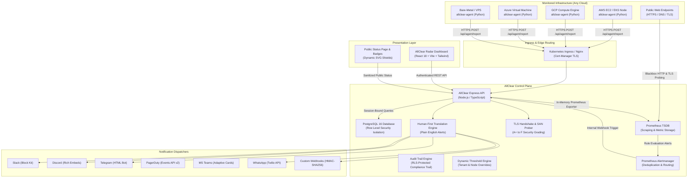
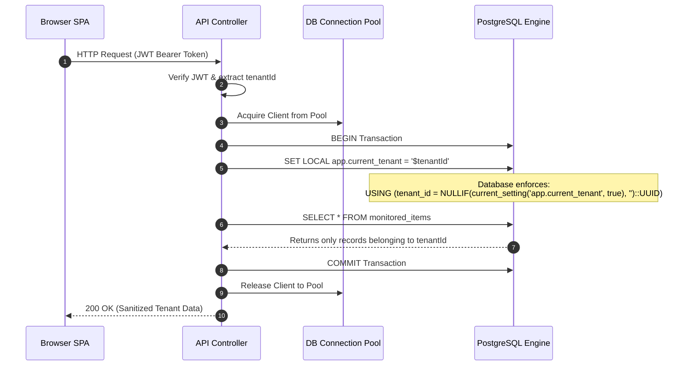

# 🏛️ AllClear Architecture & Systems Engineering Guide

> **"All Clouds. The All-Clear Status Signal."**  
> Unified multi-cloud telemetry, zero-dependency node agents, multi-tenant row-level security, and human-first operational intelligence.

---

## 1. High-Level System Architecture

---

## 2. The Double Meaning

The identity **AllClear** embodies two fundamental operational principles:

1. **"All Clouds"**:  
   Modern engineering teams operate across fractured multi-cloud estates (AWS for databases, GCP for machine learning, Azure for legacy enterprise services, DigitalOcean or bare metal for edge relays). AllClear abstracts vendor-specific lock-in, unifying multi-cloud telemetry and public web endpoints into a cohesive operational overview.

2. **"The All-Clear Status Signal"**:  
   Monitoring tools frequently overload engineers with alert fatigue, cryptic thresholds (`deriv(node_disk_usage[5m]) > 0.02`), and alarm noise. AllClear delivers an explicit, reassuring operational health signal:
   - When everything is healthy, the system explicitly broadcasts **ALL SYSTEMS CLEAR**.
   - When an anomaly occurs, AllClear translates the alert into clear human language explaining **what happened**, **why it matters**, and the **immediate suggested action**.

---

## 3. Data Flow & Row-Level Security (RLS)

AllClear enforces true multi-tenant database isolation at the database engine level via PostgreSQL Row Level Security (RLS):

### RLS Policies
- `users`: Accessible only within current tenant context.
- `monitored_items`: Isolated per tenant.
- `agent_tokens`: Isolated per tenant; queried using `SECURITY DEFINER` bypass during agent report authentication.
- `alert_history`: Logged per tenant.
- `ssl_certificates`: Isolated per tenant.
- `maintenance_windows`: Suppresses alerting for specific tenant nodes.
- `notification_channels`: Configures webhooks and chat targets per tenant.

---

## 4. Zero-Dependency Agent Architecture

The AllClear Linux agent (`agent/agent.py`) is written in pure Python 3 with **zero third-party dependencies** (`pip` not required):

- **CPU Utilization**: Computes delta between total CPU ticks and idle ticks across successive sample windows via `/proc/stat`.
- **Memory Utilization**: Reads `/proc/meminfo` extracting `MemTotal`, `MemFree`, `Buffers`, and `Cached` to calculate true Linux buffer/cache memory consumption.
- **Disk Utilization**: Calculates storage usage using `os.statvfs` with seamless fallback to `shutil.disk_usage` for cross-platform resilience.
- **Network I/O**: Parses `/proc/net/dev` calculating rolling receive/transmit transfer rates (`KB/s`) and tracking network packet errors.
- **Disk I/O Throughput**: Parses `/proc/diskstats` measuring sector read/write throughput in real time.
- **Process Discovery**: Discovers running systemd / Docker processes (`nginx`, `postgres`, `redis`, `docker`) through `/proc/[pid]/cmdline`.
- **CLI Diagnostics**:
  - `--version`: Reports agent build information.
  - `--dry-run`: Runs a single telemetry collection and prints formatted payload to stdout without network transmission.
  - `--test-config`: Validates API endpoint connectivity and token formatting.

---

## 5. Threat Model (STRIDE Framework)

| Category | Threat Identified | AllClear Defense Mechanism |
| :--- | :--- | :--- |
| **Spoofing** | Rogue node impersonating another tenant's server | Cryptographic token binding: Each agent is assigned a unique `agent_<hex>` bearer token hashed with Bcrypt. Token hash is bound strictly to `(tenant_id, monitored_item_id)`. |
| **Tampering** | Man-in-the-middle packet tampering | TLS termination with Let's Encrypt certificates; HMAC-SHA256 digital signatures on all outgoing custom webhook dispatches (`X-AllClear-Signature`). |
| **Repudiation** | Malicious deletion of incident history | Append-only transaction log in `alert_history`. Database cascades prevent historical tampering while preserving timestamped incident records. |
| **Information Disclosure** | Cross-tenant data leakage via SQL query injection | PostgreSQL `FORCE ROW LEVEL SECURITY` on all tenant-facing tables. Security definer functions strictly parameterized with UUID casting. |
| **Denial of Service** | Agent report spam flooding backend API | Token-keyed rate limiting (capped at 1 report per 10 seconds per unique node). |
| **Elevation of Privilege** | Tenant attempting to claim admin bypass | Strict separation between tenant pool client (`withTenantClient`) and admin internal queries (`adminQuery`). |

---

## 6. High Availability & Kubernetes Deployment

The platform is packaged with a cloud-native Helm chart (`infra/helm/allclear`):
- **Horizontal Pod Autoscaling (HPA)**: Dynamically scales API pods from 2 to 10 replicas based on CPU (75%) and memory (80%) utilization.
- **Pod Disruption Budgets (PDB)**: Enforces `minAvailable: 1` during node maintenance and rolling upgrades.
- **Automated TLS**: Ingress templates integrated with Cert-Manager and Let's Encrypt ClusterIssuer.
